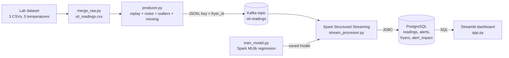
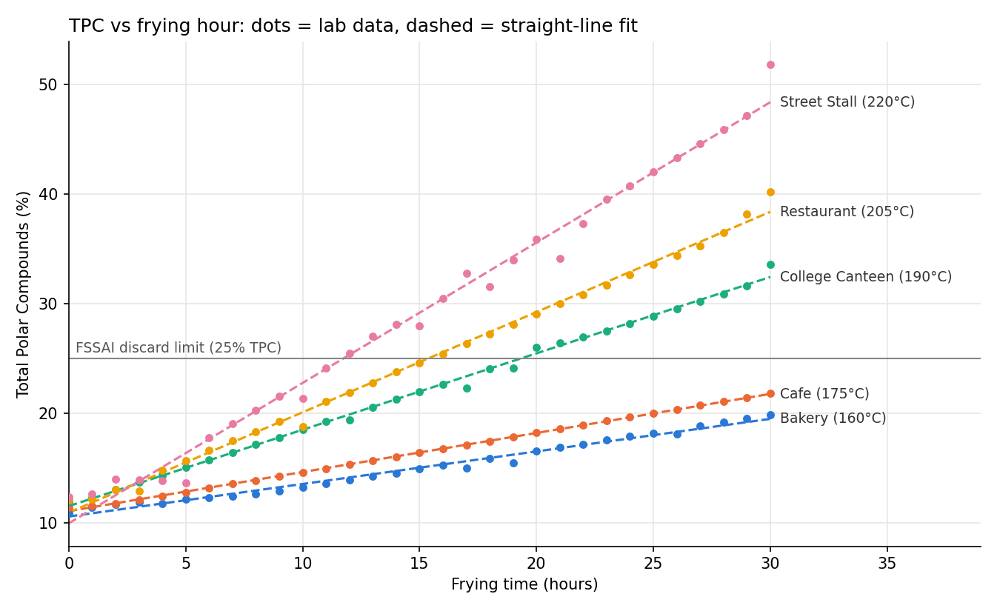

# RUCO Used Cooking Oil Tracker

Real-time monitoring of frying-oil quality per fryer, built with **Apache Kafka** and
**Spark Structured Streaming**. Mini project for *Data Analytics for Smart & Sustainable Systems* (DASSS).

Restaurants often reuse frying oil for too long. Degraded oil, with **Total Polar Compounds
(TPC) ≥ 25%**, is a health risk and must be discarded (FSSAI limit). India's **RUCO**
(Repurpose Used Cooking Oil) initiative collects such oil and turns it into biodiesel.

This project:
1. streams oil-quality readings from 5 fryers in real time,
2. cleans them (missing values, sensor-glitch outliers),
3. raises an alert when a fryer crosses the FSSAI limit,
4. predicts **how many frying hours are left** before discard,
5. shows everything, including the ESG impact (oil diverted to biodiesel), on a live dashboard.

---

## Architecture



| Component | Technology | Runs in |
|---|---|---|
| Message broker | Apache Kafka 3.8 (KRaft mode, no Zookeeper) | Docker |
| Stream processing + ML | Apache Spark 3.5.3 (PySpark, MLlib) | Docker |
| Database | PostgreSQL 16 | Docker |
| Producer (simulated sensors) | Python, kafka-python | Windows |
| Dashboard | Streamlit + Plotly, SQLAlchemy | Windows |

### Database (PostgreSQL)

| Table / view | Contents |
|---|---|
| `fryers` | Reference data: id, name, temperature, oil litres (ESG) |
| `readings` | Every cleaned reading: raw/clean/rolling TPC, z-score, outlier/missing flags, status, rate, hours left. `run_id` = which Spark run wrote it |
| `alerts` | One discard alert per fryer per oil cycle |
| `alert_impact` (view) | Alerts joined with `fryers`: oil litres → biodiesel litres (×0.85) → CO₂ avoided (×2.2 kg) |

Spark writes each micro-batch with `df.write.jdbc(...)`; the schema is in [database/init.sql](database/init.sql).
Every Spark start gets a new `run_id`; the dashboard shows the latest run, and older runs stay queryable.

**Spark job, per micro-batch (every 2 s):**
parse JSON → two-pass z-score outlier removal → forward-fill missing values →
rolling average TPC (last 10 readings = 1 frying hour) → status (WARMING_UP / OK / WARNING ≥ 22% / DISCARD ≥ 25%) →
one discard alert per fryer per oil cycle → hours left = (25 − rolling TPC) / degradation rate.

---

## Dataset

Mendeley "Frying oil data", DOI [10.17632/4k7b395yxx.1](https://doi.org/10.17632/4k7b395yxx.1).
Acid value, carbonyl value and TPC of oil used to fry potato chips at
160 / 175 / 190 / 205 / 220 °C, measured every hour from hour 0 to 30.

Each temperature is treated as one simulated fryer:

| Fryer | Temperature | Name | Oil volume (ESG assumption) |
|---|---|---|---|
| F160 | 160 °C | Bakery | 10 L |
| F175 | 175 °C | Cafe | 8 L |
| F190 | 190 °C | College Canteen | 25 L |
| F205 | 205 °C | Restaurant | 20 L |
| F220 | 220 °C | Street Stall | 15 L |

---

## Project structure

```
oil-tracker/
├── data/
│   ├── raw/                 original Mendeley CSVs
│   ├── clean/oil_readings.csv   merged: fryer_id, temperature, hour, tpc, acid_value, carbonyl_value
│   └── merge_raw.py         Step 1: wide CSVs -> one long table
├── producer/producer.py     Step 2: replays the data into Kafka as live sensor readings
├── streaming/
│   ├── stream_processor.py  Steps 3 + 5: Spark streaming job
│   └── Dockerfile           Spark 3.5.3 image + numpy (needed by MLlib)
├── model/
│   ├── plot_tpc_curves.py   checks whether TPC curves are straight or bent
│   ├── train_model.py       Step 4: trains + compares regression models (Spark MLlib)
│   ├── tpc_model/           saved MLlib model (loaded by the streaming job)
│   ├── coefficients.json, model_comparison.csv, hours_left_comparison.csv, tpc_vs_hour.png
├── dashboard/app.py         Step 6: Streamlit dashboard (reads PostgreSQL)
├── database/init.sql        PostgreSQL tables + ESG view (created on first start)
├── docker-compose.yml       Kafka + topic creation + PostgreSQL + Spark
└── requirements.txt         Python packages for the producer and dashboard
```

---

## How to run (step by step)

### 0. One-time setup on a new laptop

You need:
- **Docker Desktop** (with WSL 2), started, with "Engine running" showing.
- **Python 3.10+**. On Windows, use the `py` launcher.
- **VS Code** (optional, but this guide uses its terminal).
- **Internet**, the first time only: Docker downloads Kafka/Spark (~1.5 GB) and Spark downloads the Kafka connector.

Get the code and install the Python packages:
```powershell
git clone https://github.com/Shruti-Joshi-21/User-Cooking-Oil-Tracker-RUCO-.git oil-tracker
cd oil-tracker
py -m pip install -r requirements.txt
```

Build the images and download everything once, then stop. This makes later runs work offline:
```powershell
docker compose up -d --build
docker compose down
```

### 1. Open the project
1. Start **Docker Desktop** and wait for **"Engine running"** (bottom-left of the window).
2. Open **VS Code**, then **File → Open Folder…** and choose the `oil-tracker` folder.
3. Open a terminal: **Terminal → New Terminal**. It opens in the `oil-tracker` folder.
   If `docker` is "not recognized", close VS Code completely and reopen it.

### 2. Start Kafka, PostgreSQL and Spark (Terminal 1)
```powershell
docker compose up -d
docker compose ps -a
```
Expected: `kafka` and `postgres` are **Up (healthy)**, `oil-tracker-kafka-init-1` is **Exited (0)**
(it created the topic), and `spark` is **Up**.

Watch Spark's output (keep this terminal open):
```powershell
docker compose logs -f spark | Select-String "Loaded model|started|batch|ALERT|oil change"
```
Wait until you see:
```
Loaded model: rate(T) = -2.4919 + 0.016850 * T  (% TPC per hour)
Spark streaming started. Waiting for readings on 'oil-readings'...
```
This takes about 20–40 seconds.

### 3. Start the dashboard (Terminal 2)
Click **+** in the terminal panel (or use **Split Terminal**), then:
```powershell
py -m streamlit run dashboard/app.py
```
It opens **http://localhost:8501** and shows "Waiting for data…" until readings arrive.

### 4. Start the live data stream (Terminal 3)
```powershell
py producer/producer.py
```
Each JSON message sent to Kafka is printed. One full replay is 30 frying hours ≈ **2.5 minutes**
(1 frying hour = 5 seconds). Now watch:
- **Terminal 1:** Spark batches, outliers removed, and `*** ALERT ***` lines.
- **Dashboard:** gauges rising, statuses changing, alerts and ESG numbers growing.

Expected alerts (± a few tenths of an hour, because of the random noise):
Street Stall ≈ hour 12, Restaurant ≈ hour 16, College Canteen ≈ hour 20. Bakery and Cafe stay below 25%.

### 5. Optional extras to show the examiner

**Read the raw Kafka messages** (Terminal 4, Ctrl+C to stop):
```powershell
docker exec -it kafka /opt/kafka/bin/kafka-console-consumer.sh --bootstrap-server localhost:9092 --topic oil-readings --property print.key=true
```

**Spark web UI:** open **http://localhost:4040** and go to the **Structured Streaming** tab (input rate, batch duration).

**Query the database live** (opens the PostgreSQL shell; type `\q` to quit):
```powershell
docker exec -it postgres psql -U oil -d oiltracker
```
Useful queries to show:
```sql
\dt                                   -- list tables
SELECT * FROM fryers;

-- latest reading of every fryer in the current run
SELECT DISTINCT ON (fryer_name) fryer_name, data_hour, ROUND(tpc_rolling::numeric, 1) AS tpc, status, rate_source
FROM readings WHERE run_id = (SELECT MAX(run_id) FROM readings)
ORDER BY fryer_name, id DESC;

-- data cleaning summary per fryer
SELECT fryer_name, COUNT(*) AS readings, SUM(is_outlier::int) AS outliers, SUM(was_missing::int) AS missing
FROM readings WHERE run_id = (SELECT MAX(run_id) FROM readings) GROUP BY fryer_name;

-- alerts with ESG impact
SELECT fryer_name, data_hour, oil_litres, biodiesel_litres, ROUND(co2_avoided_kg::numeric, 1) AS co2_kg
FROM alert_impact ORDER BY ts DESC;

-- total ESG impact across all runs
SELECT SUM(oil_litres) AS oil_l, SUM(biodiesel_litres) AS biodiesel_l, ROUND(SUM(co2_avoided_kg)::numeric, 1) AS co2_kg
FROM alert_impact;
```
You can also connect with **pgAdmin** or **DBeaver**: host `localhost`, port **5433**, database `oiltracker`,
user `oil`, password `oil123`. Port 5433 is used so it doesn't clash with a locally installed PostgreSQL on 5432.

**Retrain the model** (prints the model comparison, coefficients and hours-left comparison):
```powershell
docker compose exec spark /opt/spark/bin/spark-submit /opt/app/model/train_model.py
```

**Recreate the curve plot:**
```powershell
py model/plot_tpc_curves.py
```

### 6. Reset or stop
- **Restart with clean counters** (new `run_id`, fresh Spark state; old runs stay in the database): `docker compose restart spark`.
  Wait for "Spark streaming started", then run the producer again.
- **Run the producer again without restarting Spark:** Spark detects an **oil change** (hours restart at 0), resets those fryers and keeps the ESG totals.
- **Stop the dashboard / producer:** press **Ctrl+C** in their terminals.
- **Stop Kafka, PostgreSQL and Spark:** `docker compose down`. The database data is kept.
  Don't add `-v`: it deletes the database **and** the cached connector.
- **Wipe the database completely** (fresh tables from `init.sql`): `docker compose down -v`, then `docker compose up -d` (needs internet again for the connector).

### Troubleshooting

| Problem | Fix |
|---|---|
| `docker` is not recognized | Docker Desktop not installed or terminal opened before install → fully restart VS Code |
| `error during connect` / cannot connect to Docker daemon | Start Docker Desktop and wait for "Engine running" |
| `python` opens the Microsoft Store | Use `py` instead of `python` |
| Producer: `NoBrokersAvailable` | Kafka is still starting → wait until `docker compose ps` shows **healthy** |
| Dashboard stuck on "Waiting for data" | Spark only reads messages sent **after** it started (`startingOffsets=latest`). Wait for "Spark streaming started", then run the producer again |
| Port already in use (9092 / 5433 / 4040 / 8501) | Close the old terminal or run `docker compose down`, then start again |
| Dashboard: "Cannot reach the PostgreSQL database" | `docker compose ps` → `postgres` must be **healthy**; run `docker compose up -d` |
| Browser says "Is Streamlit still running?" | The Streamlit terminal was closed → run step 3 again |

---

## Results

### Step 1: dataset
155 rows (5 fryers × 31 hours), no missing values. First hour with TPC ≥ 25%:
F220 hour 12, F205 hour 16, F190 hour 20; F160 and F175 never cross (max ≈ 19.9% and 21.8%).

### Step 3: data cleaning (one full replay, 1,505 readings)

| Check | Result |
|---|---|
| Injected spikes caught | 26 / 27 (the missed one was at hour 0.1, with no history yet) |
| Normal readings wrongly flagged | **0 / 1,478** |
| Missing values filled | 13, none left |
| Discard alerts | Street Stall 12.1 h, Restaurant 15.9 h, College Canteen 20.0 h |

Outlier settings were tuned by simulation. A 2-hour history made the mean lag behind the rising
TPC curve (thousands of false positives in simulation). A **1-hour history with a std floor of 1.0**
gave 0 false positives. A **two-pass z-score** stops one spike from hiding a second one in the same micro-batch.

### Step 4: regression model (Spark MLlib)



Each fryer's TPC rises almost in a straight line (R² ≥ 0.987 per fryer); the **slope grows with temperature**.

Leave-one-fryer-out RMSE (train on 4 fryers, test on the unseen 5th), in TPC % points:

| Model | R² | F160 | F175 | F190 | F205 | F220 | Mean |
|---|---|---|---|---|---|---|---|
| tpc ~ hour + temp | 0.851 | 5.12 | 4.41 | 0.76 | 2.44 | 6.59 | 3.87 |
| **tpc ~ hour + temp + hour×temp** | **0.981** | 3.05 | 2.36 | 0.76 | 1.02 | 2.19 | **1.87** |
| + hour² | 0.982 | 3.04 | 2.37 | 0.76 | 0.98 | 2.14 | 1.86 |

The interaction model was chosen: adding hour² does not help on unseen fryers.

```
tpc = 12.5553 − 2.4919·hour − 0.00914·temp + 0.016850·hour·temp
degradation rate at temperature T = −2.4919 + 0.016850·T   (% TPC per hour)
```
The MLlib coefficients match a numpy least-squares fit to within 1e-11.

### Step 5: live hours-to-discard
`hours_left = (25 − rolling TPC) / rate`. The rate starts as the model's rate at that temperature
(**prior**) and switches to the fryer's own measured slope (**live**) once it has ≥ 3 frying hours of
clean readings. The slope is computed from running sums of cleaned values: slope = cov(hour, TPC) / var(hour).

**Asymmetric guard.** A live slope is used only if it lies between **0.7×** and **3×** the model rate.
Faster degradation means "discard sooner", which is the safe direction, so up to 3× is accepted.
Slower degradation would overestimate the safe time, so the bound is stricter. Early readings fall in the
oil's slow "induction period"; with a symmetric 1/3× bound, Street Stall showed 24.8 h left when only about 7.6 h remained.

| Lower bound | Mean error | Worst over-estimate (unsafe) |
|---|---|---|
| 1/3× | 2.4 h | 22.3 h |
| **0.7× (used)** | **1.1 h** | **4.0 h** |

Live replay, predicted discard hour vs actual: College Canteen mean error 0.8 h, Restaurant 1.0 h,
Street Stall 1.7 h. Bakery and Cafe predictions are flagged **"extrapolated beyond lab data"** because
they never reach 25% within the 30 lab hours.

### ESG assumptions (dashboard)
Every discard alert sends that fryer's full oil volume to RUCO. 1 L of used oil → **0.85 L** biodiesel.
**2.2 kg CO₂** avoided per L of biodiesel (diesel ≈ 2.68 kg CO₂/L; used-cooking-oil biodiesel cuts lifecycle
emissions by ~80%). One full replay ≈ 60 L oil → 51 L biodiesel → 112 kg CO₂ avoided.

---

## Limitations
- The data is lab data from **one food (potato chips)** at 5 temperatures; real kitchens vary food, top up oil and filter it.
- The "sensors" are simulated by replaying and interpolating hourly lab values.
- Predictions for **Bakery (160 °C)** are unreliable: its early slope is slower than its 30-hour average, and it never reaches 25% in the data.
- Spark keeps per-fryer state in driver memory; a Spark restart starts a fresh run (fine for a single-laptop demo; past runs stay in PostgreSQL).
- ESG factors are typical published values, not measured for this oil.

## Future work

### Arrhenius-style degradation rate
The model assumes the degradation rate grows **linearly** with temperature: `rate(T) = b_hour + b_int × T`.
The lab data suggests it grows faster than linearly (closer to exponential, as in the Arrhenius equation for chemical reaction rates):

| Fryer | Model rate (%/h) | Lab slope (%/h) |
|---|---|---|
| 160 °C | 0.204 | 0.298 |
| 175 °C | 0.457 | 0.347 |
| 190 °C | 0.710 | 0.724 |
| 205 °C | 0.962 | 0.937 |
| 220 °C | 1.215 | 1.317 |

A future version could model `log(rate) = a + b × T` (rate = A·e^(bT)), which would fix the under-estimate
at 160 °C and the over-estimate at 175 °C. We did not implement it because it would rest on only 5 temperature
points; instead, the live stream corrects the rate with each fryer's own measured slope.

### Other ideas
- Real sensor: a simulated ESP32 (Wokwi) → MQTT → Python bridge → the same Kafka topic.
- Also publish alerts to a Kafka `alerts` topic so other systems can subscribe to them.
- Notify the RUCO collection agency automatically (SMS/email) when an alert fires.
